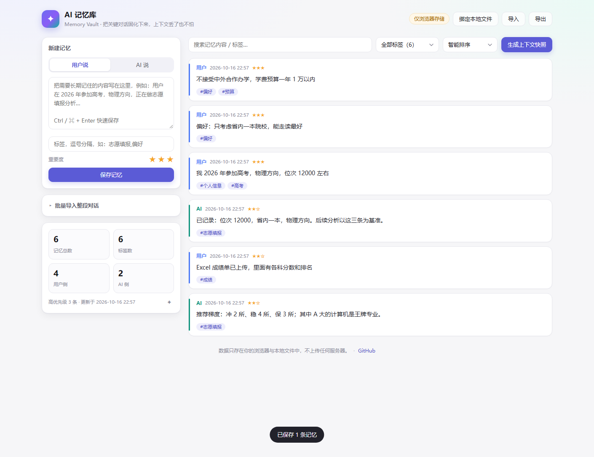
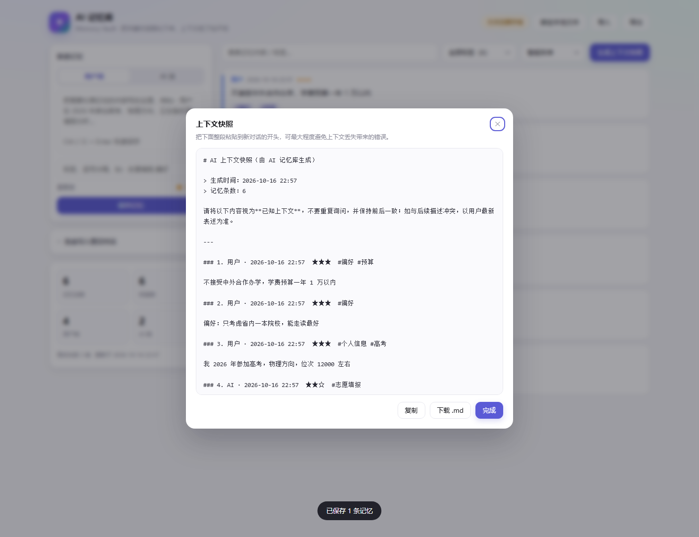
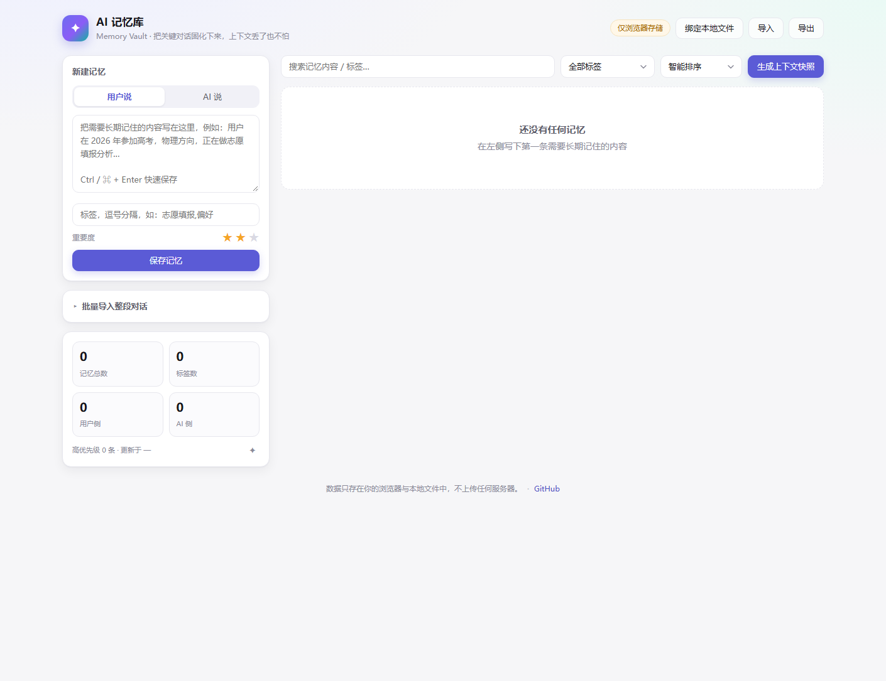
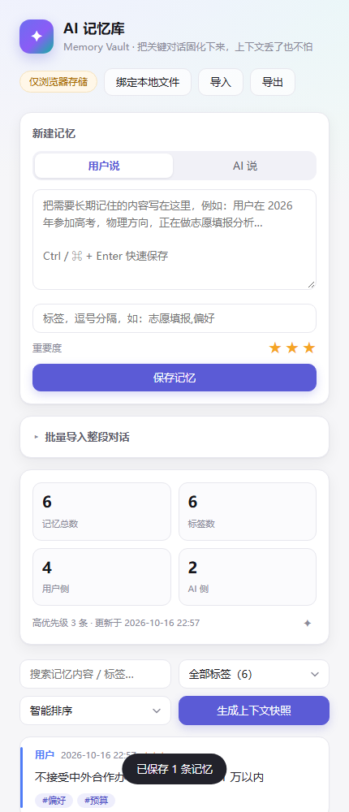
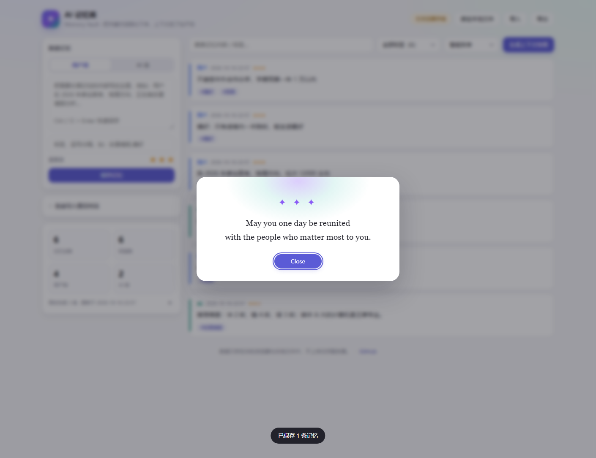

<div align="center">

# AI 记忆库 · Memory Vault

**把关键对话固化成本地记忆，一键生成上下文快照 —— 上下文丢了，AI 也不会答错。**

[](https://github.com/rechen521/ai-memory-vault/actions/workflows/ci.yml)
[](LICENSE)
[](package.json)
[](#快速开始)
[](.github/workflows/ci.yml)

[在线使用](https://rechen521.github.io/ai-memory-vault/) · [功能](#功能一览) · [开发](#本地开发) · [English](#english)



</div>

---

## 它解决什么问题

和 AI 聊久了都会遇到同一类事故：

- 上下文被截断，AI 忘了你三小时前说过的偏好，又给了一遍早就被否掉的方案；
- 换到新会话 / 新模型，一切背景从零讲起，重复劳动；
- 关键信息散落在几十个会话里，想找回来只能靠翻聊天记录。

AI 记忆库把「值得长期记住的事」抽出来存在你自己机器上，需要时一键生成一段结构化的 **上下文快照**，粘到新会话开头即可 —— 不用重讲背景，也不会因为记忆丢失而答错。

**数据只存在你的浏览器和本地文件里，不上传任何服务器。** 整个应用是一个 HTML 文件，零依赖、双击即用。

## 快速开始

**方式一：直接打开在线版**（推荐先试）

> https://rechen521.github.io/ai-memory-vault/

**方式二：下载单文件到本地**（数据完全离线，可断网使用）

从 [Releases](https://github.com/rechen521/ai-memory-vault/releases) 下载 `ai-memory-vault.html`（CI 会把它作为构建产物上传，也可以直接右键保存[在线版](https://rechen521.github.io/ai-memory-vault/)页面），双击用浏览器打开即可。想让它把记忆落盘成 JSON，请用 **Chrome / Edge** 打开并点击右上角「绑定本地文件」。

> `dist/` 是构建产物，不提交到仓库；`npm run build` 会在本地生成 `dist/index.html` 与 `dist/ai-memory-vault.html`（同一份内容）。

**方式三：从源码构建**

```bash
git clone https://github.com/rechen521/ai-memory-vault.git
cd ai-memory-vault
npm run build        # 生成 dist/index.html（零依赖，不需要 npm install）
```

## 功能一览

| 能力 | 说明 |
|---|---|
| 记忆录入 | 角色（用户 / AI）、标签、重要度 1–3 星；`Ctrl / ⌘ + Enter` 或标签框回车即可保存 |
| 批量导入 | 粘贴整段对话，自动按 `用户：/ AI：/ User: / Assistant: / 我：` 等前缀切分入库；识别不到前缀时兜底存为单条并打 `批量导入` 标签 |
| 检索 | 全文搜索（内容 + 标签）、标签下拉筛选、标签 chip 点击筛选、三种排序（智能 / 最新 / 最早） |
| 卡片操作 | 置顶、内联编辑、删除（带确认）；编辑草稿在筛选重绘时不会丢 |
| 统计面板 | 总数、标签数、用户侧、AI 侧、高优先级条数、最后更新时间 |
| **上下文快照** | 一键生成结构化 Markdown（时间 / 星级 / 标签 / 置顶标记 / 筛选范围），可复制到剪贴板或下载 `.md` |
| **双保险持久化** | `localStorage` 常驻 + File System Access API 绑定本地 JSON 自动落盘（去抖 400ms，页面切到后台立即写入） |
| 备份与迁移 | JSON 导入 / 导出，导入按 `id` + 内容指纹双重去重，不会重复也不会覆盖 |
| 彩蛋 | 每次会话首次打开弹出：*May you one day be reunited with the people who matter most to you.*（统计面板右下角 `✦` 可重现） |

### 上下文快照长什么样



```markdown
# AI 上下文快照（由 AI 记忆库生成）

> 生成时间：2026-10-16 22:22
> 记忆条数：2

请将以下内容视为**已知上下文**，不要重复询问，并保持前后一致；如与后续描述冲突，以用户最新表述为准。

---

### 1. 用户 · 2026-10-16 22:22  ★★★  [置顶]  #个人信息 #高考

我 2026 年参加高考，物理方向，位次 12000 左右

---

（以上为历史记忆，请在此基础上继续。）
```

把这段粘到新会话的第一条消息即可。更多用法（当作 system prompt、让 AI 直接读文件、固定指令模板）见 [docs/ai-integration.md](docs/ai-integration.md)。

<details>
<summary>更多界面截图（空状态 / 窄屏）</summary>




</details>

### 快捷键与细节

| 操作 | 效果 |
|---|---|
| `Ctrl / ⌘ + Enter` | 在记忆内容框里直接保存 |
| 标签框内 `Enter` | 保存当前记忆 |
| `Esc` | 关闭当前弹窗 |
| 点击标签 chip | 按该标签筛选 / 取消筛选 |
| 点击顶部状态徽标 | 未绑定 → 触发绑定；已绑定但失去授权 → 重新授权并立即同步 |

## 本地开发

**只需要 Node.js ≥ 18**（自带 `fetch` 与全局 `WebSocket`）。运行时和开发时都是 **零依赖**，`npm install` 不是必需的。

```bash
npm run dev       # 起本地静态服务器预览 src/（默认 http://127.0.0.1:8777）
npm run build     # src/ → dist/index.html（单文件、零依赖、未压缩，方便审计）
npm run check     # 静态自检：JS 语法、DOM id 交叉引用、产物完整性
npm test          # 24 项单元测试（数据层 / 持久化层纯逻辑）
npm run test:e2e  # 46 组真实浏览器 E2E 断言（系统 Edge / Chrome + CDP）
npm run test:file # 直接用 file:// 打开产物，验证「双击即用」
npm run verify    # 上面全部跑一遍
npm run shots     # 重新生成 README 截图
```

### 项目结构

```
src/index.html          页面骨架（含 <!-- build:css --> / <!-- build:js --> 内联标记）
src/styles.css          全部样式
src/js/util.js          通用工具：转义、安全 id、时间格式化、下载、剪贴板
src/js/parser.js        纯文本 → 结构化记忆（标签解析、对话切分）
src/js/store.js         数据层：规范化、筛选排序、统计、导入合并、导出结构
src/js/snapshot.js      上下文快照 Markdown 生成
src/js/filestore.js     localStorage / IndexedDB / File System Access
src/js/ui.js            渲染与事件绑定
scripts/build.mjs       零依赖打包：按依赖顺序内联，去掉 import/export
scripts/check.mjs       静态自检
tests/unit.test.mjs     单元测试（node --test）
tests/e2e.mjs           浏览器端到端测试
tests/lib/browser.mjs   CDP 驱动封装（系统浏览器 + Node 内置 WebSocket）
```

<details>
<summary>为什么自己写打包脚本，而不是用 esbuild / Vite？</summary>

本项目的核心承诺是「单文件、零依赖、双击即用」。引入打包器会让开发链路多出 `node_modules`（几十 MB）和一套工具链配置，而这里真正需要的只是「按固定顺序拼接 + 去掉 `import` / `export` 关键字」。`scripts/build.mjs` 用几十行完成这件事，并且：

- 违反内联约定（跨行 import、`export default`、动态 import）会**在构建时报错**，而不是产出一个坏文件；
- 产物不压缩，用户拿到手就能读、能审计；
- 构建脚本自己会校验产物：语法可解析、没有残留的外链 `<script src>` / `<link stylesheet>`。

代价是模块必须遵守两条约定（见 [CONTRIBUTING.md](CONTRIBUTING.md)），对这个小项目来说是划算的。
</details>

### 测试策略

- **单元测试**覆盖纯逻辑：转义与 id 净化、标签解析、对话切分、记忆规范化、筛选排序、统计、导入合并、快照生成、`localStorage` 容错、文件同步去抖。
- **E2E 用真实浏览器**跑完整用户路径：录入 → 检索 → 置顶 → 编辑 → 删除 → 批量导入 → 快照 → 剪贴板 → 导出 → 导入（含重复导入去重）→ XSS 注入 → 彩蛋弹窗 → 刷新持久化 → 损坏数据恢复 → 窄屏布局 → 无障碍属性，并断言**全程无未捕获异常、控制台无 error**。
- E2E 不依赖 Playwright：用系统已装的 Edge / Chrome，通过 CDP 驱动（`tests/lib/browser.mjs`），所以 CI 里也不需要下载浏览器。
- `npm run test:file` 单独用 `file://` 打开产物跑一遍，确认「双击 HTML 就能用」这件事没有因为构建或 API 变化而失效。

## 数据与隐私

- 记忆只写入两处：浏览器 `localStorage`（key `mvault.v1`）和你自己选择绑定的本地 JSON 文件；
- 页面**不发任何网络请求**（唯一外链是页脚的 GitHub 地址）；
- 快照是你手动复制、粘贴给你选择的 AI 服务的，涉及敏感信息时建议先用标签筛掉再生成；
- 想彻底清空：清掉浏览器站点数据即可，或先把记忆全部导出备份。

数据格式（含 JSON Schema 与导入容错规则）见 [docs/data-format.md](docs/data-format.md)。

## 浏览器兼容

| 浏览器 | 基本可用 | 绑定本地文件自动落盘 |
|---|---|---|
| Chrome / Edge 86+ | ✅ | ✅ |
| 其它 Chromium 系 | ✅ | ✅（多数） |
| Firefox / Safari | ✅（退化为浏览器存储 + 手动导出 JSON） | ❌ |

File System Access API 仅在 Chromium 系可用；不支持的浏览器会退化成「浏览器存储 + 手动导出」，防丢失能力仍在，只是需要你偶尔点一下导出。

## 已知限制

- 记忆是**文本 + 标签**，关键词检索，不是语义/向量检索；
- 单条记忆上限 20000 字符，每条最多 12 个标签（出于 `localStorage` 容量与可读性考虑）；
- 绑定文件后如果浏览器重启，可能需要在徽标上点一下重新授权（浏览器安全策略要求用户手势）；
- 多标签页同时打开同一份数据时，后写入的会覆盖先写入的（没有做多端冲突合并）。

## 路线图

- [ ] 记忆分组 / 多记忆库切换
- [ ] 快照模板自定义（可切换英文快照、精简模式）
- [ ] 按标签组合生成「人设卡」式的固定 system prompt
- [ ] PWA 离线安装
- [ ] 可选的语义检索（本地 embedding，仍然零上传）

欢迎在 [Issues](https://github.com/rechen521/ai-memory-vault/issues) 提需求，或直接提 PR（见 [CONTRIBUTING.md](CONTRIBUTING.md)）。

## 致谢与由来

这个工具的原始需求来自一次真实对话 —— 想要一个「保存 AI 与用户对话记忆、防止上下文丢失」的小工具，结尾带一句英文彩蛋：*May you one day be reunited with the people who matter most to you.* 原始原型是单文件 `ai-memory-vault.html`，本仓库在保留全部功能与视觉的前提下重组织了源码、补齐了测试并修掉了原型里的一个属性注入型 XSS（详见 [docs/dev-record.md](docs/dev-record.md) 与 [CHANGELOG.md](CHANGELOG.md)）。

## License

[MIT](LICENSE) © 2026 rechen521

---

<div align="center">



*May you one day be reunited with the people who matter most to you.*

</div>

---

## English

**AI Memory Vault** — conversation-based AI memory: saves chat history and extracts long-term facts, so the AI can remember you across sessions. Turn important chat context into durable local memories, then generate a copy-paste **context snapshot** so a fresh AI session (or a truncated one) never loses your background.

- **Single HTML file, zero dependencies.** Build with `npm run build`, download the artifact from Releases, or open the [live demo](https://rechen521.github.io/ai-memory-vault/) — it even works offline.
- **Local-first.** Memories live in your browser's `localStorage` and, optionally, in a local JSON file you bind via the File System Access API. No network requests are made.
- **Context snapshot.** One click produces structured Markdown (role, time, importance stars, tags, pinned flag, filter scope) ready to paste at the top of a new conversation.
- **Rich tooling.** Role/tag/star capture, bulk paste-import with automatic role splitting, full-text search, tag filters, three sort modes, pin/edit/delete, statistics, JSON import/export with duplicate-safe merging.
- **Verified.** 24 unit tests plus 46 real-browser E2E assertion groups (headless Edge/Chrome over CDP), including XSS hardening, clipboard, import/export round-trip, persistence and corrupted-storage recovery.

Quick start:

```bash
git clone https://github.com/rechen521/ai-memory-vault.git
cd ai-memory-vault
npm run build     # → dist/index.html (no install step needed)
npm run verify    # build + static checks + unit tests + browser E2E
```

Live demo: <https://rechen521.github.io/ai-memory-vault/>

Data format: [docs/data-format.md](docs/data-format.md) · Using it with AI: [docs/ai-integration.md](docs/ai-integration.md) · Contributing: [CONTRIBUTING.md](CONTRIBUTING.md)

MIT © 2026 rechen521
